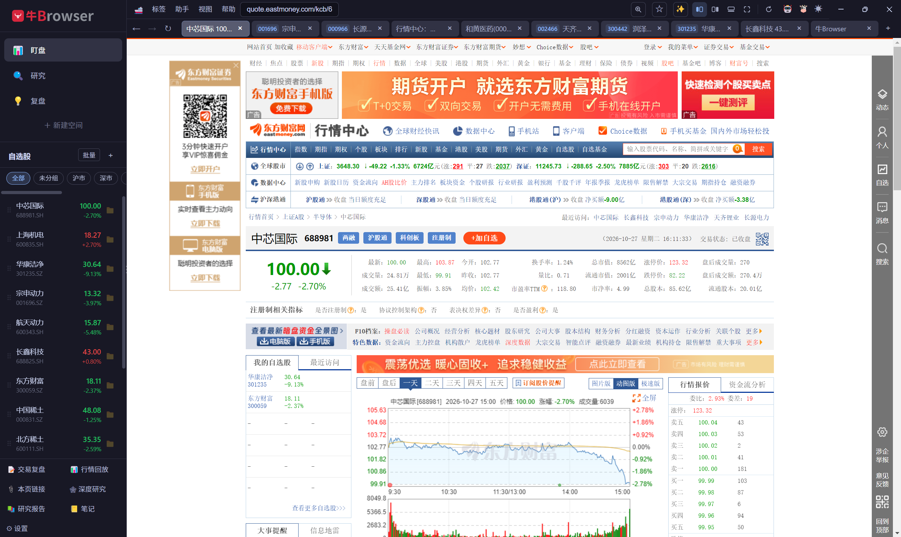
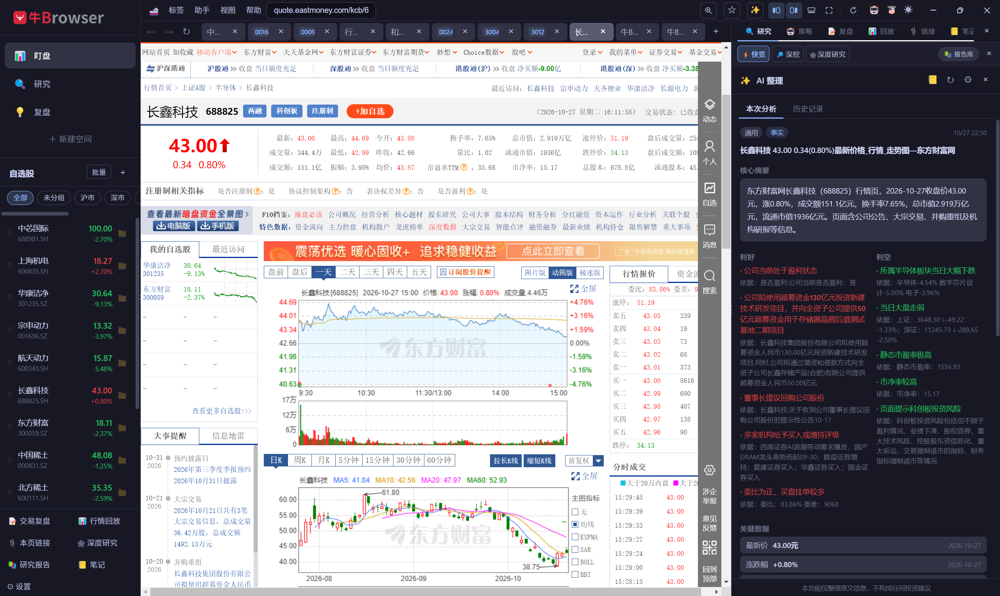
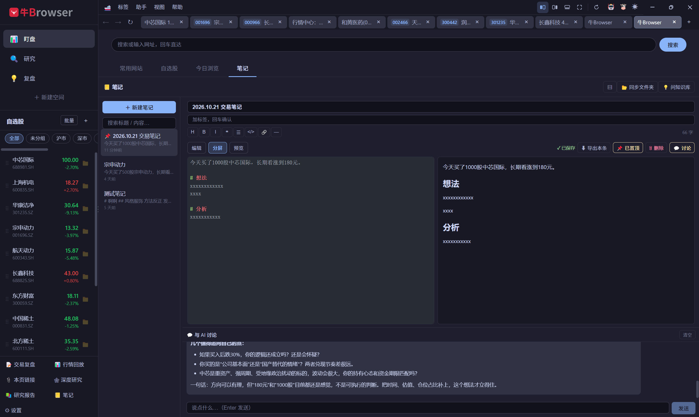
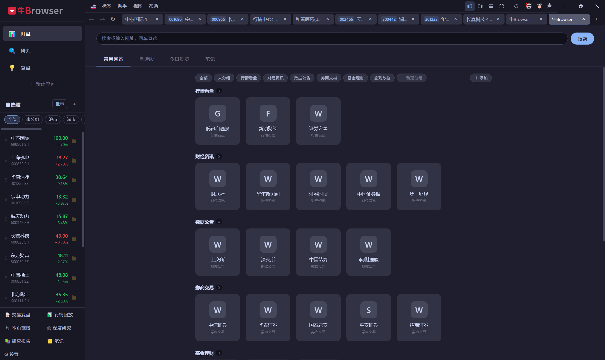
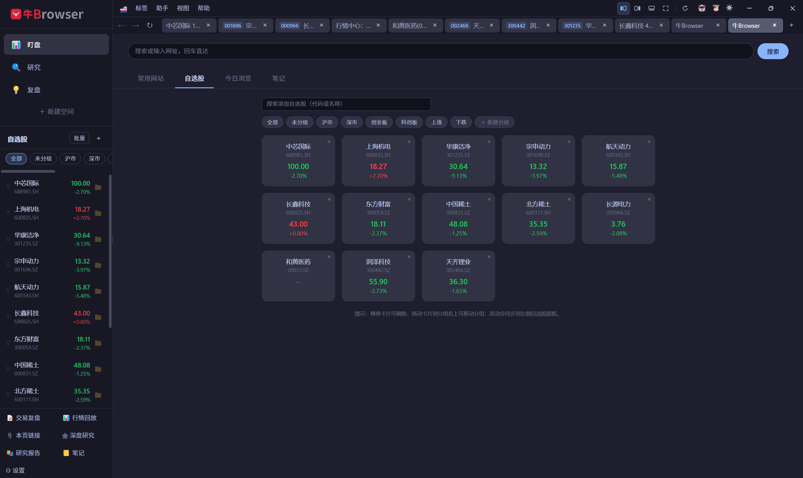

<p align="center">
  
</p>

# 牛Browser · NBrowser

> 面向个人投资者的**桌面端专用浏览器**。不是通用浏览器的竞品，而是把「看盘 → 研究 → 复盘」这条投资主链路固化为产品结构：用浏览器外壳承载你本来就每天要打开的东方财富、同花顺、雪球、巨潮资讯等站点，并在之上叠加 **自选股行情、浏览轨迹记录、股票识别、AI 信息整理** 四层能力。

[](LICENSE)
[](#)
[](https://www.electronjs.org/)
[](https://react.dev/)
[](https://www.typescriptlang.org/)

---

## 📸 截图预览

盯盘空间：东方财富行情页 + 侧边栏常驻自选股（涨红跌绿）



<table>
  <tr>
    <td width="50%"><p align="center"><sub>🔍 研究：AI 整理当前页，输出利好 / 利空要点与关键数据</sub></p></td>
    <td width="50%"><p align="center"><sub>📒 笔记：Markdown 编辑 + 随笔记 AI 讨论</sub></p></td>
  </tr>
  <tr>
    <td width="50%"><p align="center"><sub>🏠 导航首页：内置分类常用网站，可自定义分组</sub></p></td>
    <td width="50%"><p align="center"><sub>📈 自选股：卡片网格管理，实时行情联动</sub></p></td>
  </tr>
</table>

---

## ✨ 核心特性

- **按投资流程分空间**：内置「盯盘 📊 / 研究 🔍 / 复盘 📝」三个空间，标签页与登录态彼此隔离；同一网站可在不同空间登录不同账号。空间列表可自定义增 / 删 / 改名。
- **行情常驻**：自选股行情在侧边栏常驻显示（涨红跌绿，A 股习惯），无需来回切页面看盘；支持自定义分组与按市场 / 涨跌的智能分组。
- **自动记录浏览轨迹**：自动把「我在哪只股票上花了多少时间」记录并聚合下来，解决复盘时「我那天到底看了啥」的问题；支持按日期 / 空间过滤与 CSV / JSON 导出。
- **AI 只做信息整理，不做投资建议**：严格禁止预测价格与给出买卖建议，只输出事实摘要、利好 / 利空要点、关键数据、存疑点；社区内容强制标注「观点非事实」。
- **AI 助手（Copilot）**：`Cmd/Ctrl + K` 全局召唤，多轮会话持久化，内置 7 个只读内部数据工具（自选 / 持仓 / 研究轨迹 / 笔记 / 报告 / 行情 / 策略）+ 联网检索，带双层合规护栏。
- **交易记录与复盘笔记**：录入 / 导入券商交割单 / 自然语言录入交易，自动计算盈亏与胜率，逐笔绑定复盘笔记，形成「交易 ↔ 决策依据」闭环。
- **AI 量化策略**：用大白话生成策略规则，支持历史回测、实时运行监控（买卖点提示）与手动编辑规则。
- **网页独立窗口（多屏）**：标签可弹出为独立窗口，登录态 / 播放进度全部保留，支持双向搬运与按显示器记忆布局；关闭窗口自动收回标签。
- **会话恢复**：重启后按空间还原标签与独立窗口（连同窗口内整组标签摆回原显示器）。

---

## 🧱 技术栈与架构

| 维度 | 选型 |
| --- | --- |
| 运行时 | Electron 32 + Node 22 |
| UI | React 18 + TypeScript 5.7 |
| 构建 | electron-vite 5 + Vite 6（main / preload / renderer 三段式） |
| 存储 | `sql.js`（SQLite WASM，纯内存 + 手动落盘），**不依赖原生模块** |
| 测试 | Vitest 2（覆盖纯函数与 DAO） |
| 行情 | 东方财富 / 腾讯财经公开接口（免费、无需 Key），Provider 可插拔 |
| LLM | OpenAI 兼容 `/chat/completions`，用户自填 baseUrl / apiKey / model |

**关键架构约束**

- 主进程与渲染进程的所有通信均走 `src/shared/ipc.ts` 定义的**单一契约源**，禁止裸字符串通道。
- 渲染进程无 Node 能力：`contextIsolation` + `sandbox`；preload 按来源校验，外部站点零暴露 IPC。
- 所有 IPC handler 不信任渲染进程入参，逐参数校验。
- 敏感信息（LLM API Key）存 `userData/config.json`，**不入库、不提交 git**；业务数据存 `userData/stock-browser.db`。

```
src/
├── main/        主进程：窗口/标签/空间、IPC 处理、行情轮询、AI、存储、策略
├── preload/     上下文隔离桥接（仅暴露白名单 invoke / 事件订阅）
├── renderer/    React UI 外壳（侧栏 / 标签栏 / 地址栏 / 面板）
└── shared/      主渲染共享：IPC 契约、纯函数（识别/判定/盈亏/合规）、类型
```

---

## 🚀 快速开始（开发）

要求 Node 22+ 与 [pnpm](https://pnpm.io/)。

```bash
# 安装依赖
pnpm install

# 启动开发模式（热重载）
pnpm dev

# 运行单元测试
pnpm test

# 类型检查
pnpm exec tsc --noEmit
```

> 行情功能使用公开免费接口，无需任何 Key 即可使用。AI / Copilot / 策略等能力需要在「设置 → LLM」中填写可用的 OpenAI 兼容接口地址与 Key 后启用。

---

## 📦 打包分发

```bash
# Windows 安装包（NSIS）
pnpm dist

# 仅生成目录（不打包）
pnpm dist:dir

# macOS 磁盘镜像（DMG）
pnpm dist:mac
```

产物输出到 `release/`（已在 `.gitignore` 中忽略）。

---

## ⚙️ 配置

应用配置位于 `userData/config.json`（首次运行自动生成，不入库）：

```json
{
  "llm":   { "baseUrl": "https://api.openai.com/v1", "apiKey": "", "model": "gpt-4o-mini", "fastModel": "" },
  "quote": { "provider": "eastmoney", "tradingIntervalMs": 5000, "nonTradingIntervalMs": 60000 }
}
```

- **LLM**：支持任意 OpenAI 兼容服务；设置界面内置多家厂商预设，API Key 不回显明文。
- **行情数据源**：内置东方财富（默认）/ 腾讯财经，或自定义 HTTP API（URL 模板 + 字段路径映射）；连续失败自动降级并提示。

---

## 🔒 合规与免责声明

- 本软件**不提供任何投资建议、目标价预测、买卖点提示**，也不对接任何券商交易下单接口。
- AI 功能仅做信息整理（摘要 / 利好利空要点 / 关键数据 / 存疑点），所有结论须以官方披露为准，投资损益由使用者自行承担。
- 浏览轨迹等隐私数据**纯本地单机存储**，不上传任何服务器；可一键关闭、按域名屏蔽或一键清空。
- 本软件仅供学习与技术研究使用，请遵守所在地区法律法规与证券市场相关规定。

---

## 🧪 测试

核心识别 / 判定 / 计算逻辑均为纯函数并配套单测（股票代码提取、交易时段与节假日历、代码市场规范化、盈亏计算、CSV 导出、券商交割单导入、自然语言交易解析、会话恢复布局等）。

```bash
pnpm test          # 运行全部用例
pnpm test:watch    # 监听模式
```

---

## 🗺️ 功能实现状态

当前为 `v0.1.0`（MVP 开发中）。浏览器外壳、三空间、标签管理、导航首页 / 书签、自选股、行情、浏览轨迹、股票识别、AI 分析、交易 / 复盘、行情历史回放、AI 助手、研究模块、行动层、策略、笔记、网页独立窗口、会话恢复等模块均已实现。详见 [`docs/需求文档.md`](docs/需求文档.md)（PRD，含完整功能清单与实现状态）。

---

## 🤝 贡献

欢迎 Issue 与 PR。提交前请确保：

```bash
pnpm exec tsc --noEmit
pnpm test
```

代码风格以项目现有约定为准；新增外部依赖（行情 / 股票识别 / AI）请抽象为 Provider / 纯函数，新增主渲染通信请走 `src/shared/ipc.ts`。

---

## 📄 许可证

本项目以 **MIT 许可证** 开源，详见 [LICENSE](LICENSE)。名称与品牌标识的使用受 [TRADEMARKS.md](TRADEMARKS.md) 约束（衍生 / 商业发布须改名换标）。

---

<p align="center">牛Browser · 看盘、研究、复盘，一个窗口搞定。</p>
